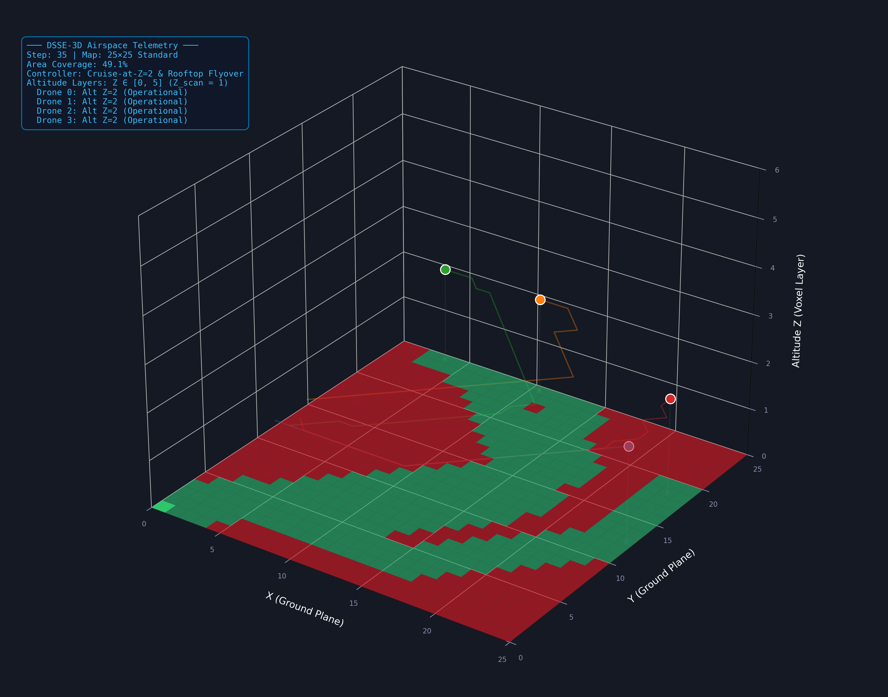
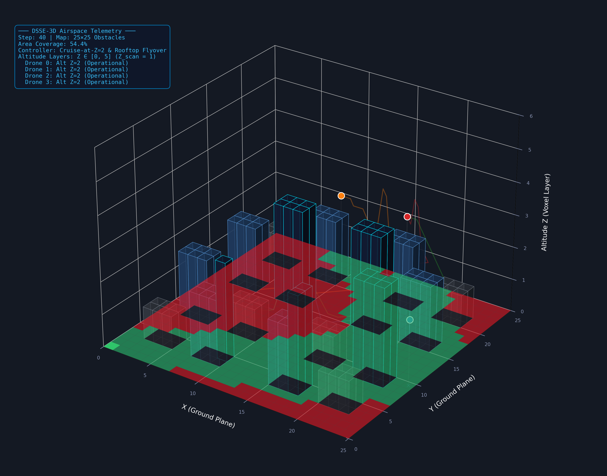
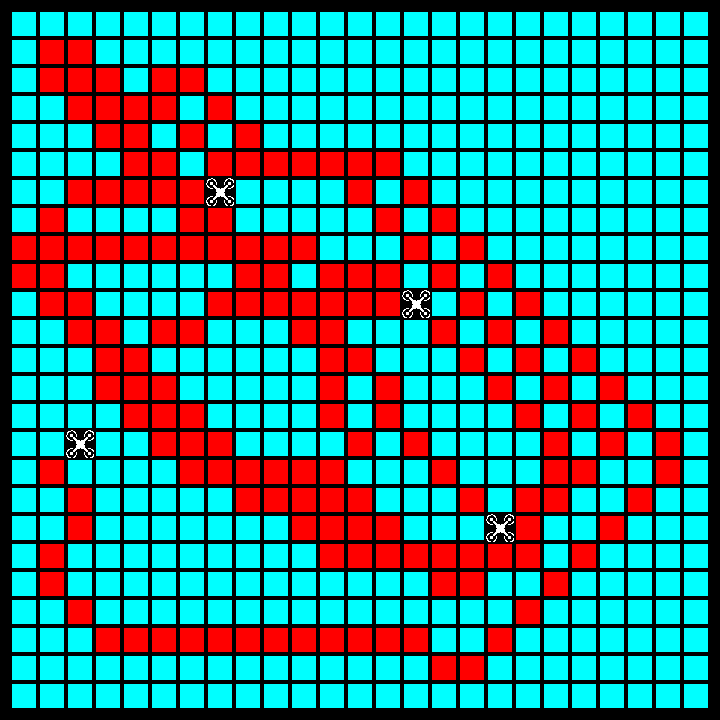
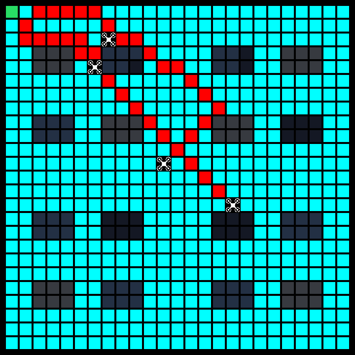

# Resilient Multi-UAV Swarm Search, Coverage, and Target Tracking Under In-Flight Actuator Faults

[](https://www.python.org/downloads/)
[](https://pytorch.org/)
[](https://docs.ray.io/en/latest/rllib/index.html)
[](https://pettingzoo.farama.org/)
[](LICENSE)
[-purple.svg)]()

> **Honours Thesis Research Repository**  
> Autonomous Decentralized Multi-Agent Reinforcement Learning with Self-Healing Architectures for Multi-UAV Swarms in 2D Planar and 3D Volumetric Airspaces.  
> *Note: This repository is a research fork of the [Drone Swarm Search Environment (DSSE)](https://github.com/pfeinsper/drone-swarm-search) and its algorithm framework [drone-swarm-search-algorithms](https://github.com/pfeinsper/drone-swarm-search-algorithms), extending the platform with volumetric 3D dynamics (DSSE-3D), in-flight actuator degradation models, physical obstacle collision wrappers, self-healing neural architectures (RSPO), and comprehensive benchmarking suites.*

---

## 3D Simulation Environments

<p align="center">
  
  
</p>
<p align="center">
  <em>Figure 1: (Left) DSSE-3D continuous volumetric airspace showing 4-drone multi-layer flight trajectories (Z=1 scan, Z=2 cruise), altitude drop-lines, ground search footprints, and live telemetry HUD. (Right) DSSE-3D urban obstacle environment featuring semi-transparent high-rise building prisms with height-stratified coloring, rooftop flyover clearance routing, and base station operations.</em>
</p>

<p align="center">
  
  
</p>
<p align="center">
  <em>Figure 2: In-game DSSE 2D simulator views. (Left) Standard 25x25 open grid showing drone exploration paths and probability decay. (Right) 25x25 urban obstacle grid displaying the emerald charging station at (0,0), multi-height obstacle footprints, and drone sprites navigating narrow ground corridors.</em>
</p>

---

## Executive Summary

Autonomous unmanned aerial vehicle (UAV) swarms operating in search-and-rescue, disaster relief, and hostile reconnaissance face severe real-world disruptions:
- **In-Flight Actuator Faults:** Unannounced, irreversible motor failures modeled as Poisson arrival processes.
- **Strict Energy Budgets:** Fixed battery capacities requiring periodic sorties to an origin charging base station.
- **Physical Obstacle Collisions:** Dense urban high-rise skyline obstacles requiring either evasive ground routing (2D) or vertical flight clearance (3D).

Standard multi-agent reinforcement learning (MARL) algorithms assume hardware invariance during deployment. When hardware failures occur, their spatial coordination collapses, resulting in deadlocks, battery depletion, or mid-air collisions.

This repository implements **RSPO (Resilient Swarm Policy Optimization)**, an on-policy decentralized actor-critic architecture equipped with a modular **Self-Healing mechanism**. RSPO enables homogeneous drone swarms to dynamically detect peer failures, infer fleet health, reorganize spatial search perimeters in real time, and balance urgent exploration with conservative base-station recharging.

---

## RSPO Architecture and Self-Healing Innovations

```
                              +------------------------------------------+
                              |       RAW SWARM OBSERVATIONS             |
                              |  - Spatial Probability Grid: (25x25)     |
                              |  - Local Telemetry / Kinematics: (22-dim)|
                              +--------------------+---------------------+
                                                   |
                   +-------------------------------+-------------------------------+
                   |                               |                               |
                   v                               v                               v
       +-----------------------+       +-----------------------+       +-----------------------+
       | Spatial CNN Backbone  |       |     Kinematic MLP     |       | Fleet Health Extractor|
       | (Conv2D + Flatten)    |       |   (Dense 512 -> 256)  |       |  (14-dim Status -> 32)|
       +-----------+-----------+       +-----------+-----------+       +-----------+-----------+
                   | 256-dim                       | 256-dim                       | 32-dim (h_t)
                   +-------------------------------+-------------------------------+
                                                   |
                                                   v
                                 +-----------------------------------+
                                 | FEATURE FUSION LAYER (544-dim)    |
                                 |  [Spatial || Kinematic || FHE]    |
                                 +-----------------+-----------------+
                                                   |
                   +-------------------------------+-------------------------------+
                   |                                                               |
                   v                                                               v
       +-----------------------+                                       +-----------------------+
       |     ACTOR NETWORK     |                                       |   DOVD CRITIC NETWORK |
       |  (Dense 256 -> Logits)|                                       |  (V_search + a*V_take)|
       +-----------+-----------+                                       +-----------+-----------+
                   | Action Probabilities pi(a|s)                                  | State Value V(s)
                   v                                                               v
       +-----------------------+                                       +-----------------------+
       | RAC Dynamic Clipping  | <-------------------------------------| Learned Gating a_t    |
       | e_t = 0.10 + 0.20*RAC |                                       | Multi-Head Value Est. |
       +-----------------------+                                       +-----------------------+
```

### Core Self-Healing Innovations
1. **Fleet Health Embedding (FHE):** Encodes the operational state of all peers into a low-dimensional learned latent vector h_t in R^32.
2. **Crash-Sector Spatial Attention (CSSA):** Modulates the spatial feature map with Gaussian heatmaps centered on the last known positions of fallen peers, prompting healthy survivors to prioritize orphaned search sectors. Includes a verified inference-time switch (`--cssa_mode {trained, off, corrected}`).
3. **Dual-Objective Value Decomposition (DOVD):** Separates exploratory search rewards from logistical base-station return rewards into distinct value streams.
4. **Resilience-Adaptive Clipping (RAC):** Dynamically widens PPO policy clipping bounds when peer failure is detected, accelerating policy reorganization.
5. **Dynamic Sector Compensation Reward:** Rebalances the team reward structure upon hardware loss to reward survivors filling coverage gaps.

---

## Evaluation Suite (40 Scenarios)

Every model is benchmarked across **40 distinct scenarios** (100 independent evaluation seeds each, totaling 48,000 evaluated episodes):

| Dimension | Grid Topologies | Obstacle Skyline | In-Flight Fault Rates (p) | Seeds |
| :--- | :--- | :--- | :--- | :--- |
| **2D Planar** | 25x25, 50x50 | Standard (Open), Obstacles (High-Rise Skyline) | 0.0, 0.00025, 0.0005, 0.00075, 0.001 | 1000-1099 |
| **3D Volumetric (DSSE-3D)** | 25x25, 50x50 | Standard (Open), Obstacles (Over-flight clearance) | 0.0, 0.00025, 0.0005, 0.00075, 0.001 | 1000-1099 |

### Evaluated MARL Models and Baselines (12 Models)

1. **RSPO Vanilla** (On-Policy Decentralized Actor-Critic Baseline)
2. **RSPO Self-Heal** (Full Architecture with FHE, CSSA, DOVD, RAC)
3. **MAPPO Vanilla** (Multi-Agent PPO with Centralized Critic)
4. **MAPPO Self-Heal** (Centralized Critic + Fault Observations)
5. **QMIX Vanilla** (Monotonic Factorized Value Function)
6. **QMIX Self-Heal** (State-Conditioned Mixing Network)
7. **MAA2C Vanilla & Self-Heal** (Advantage Actor-Critic)
8. **COMA Vanilla & Self-Heal** (Counterfactual Multi-Agent Policy Gradients)
9. **I-DQN Vanilla & Self-Heal** (Independent Deep Q-Networks)
10. **Greedy Frontier Baselines** (Deterministic Non-RL Upper Baselines)

---

## Swarm Mission Efficiency Index (SMEI)

To balance search thoroughness with fleet survival and energetic efficiency, performance is quantified via the **Swarm Mission Efficiency Index (SMEI)**:

$$\text{SMEI} = 100 \times C^{0.4} \times S^{0.3} \times B^{0.3}$$

- **Coverage Rate (C in [0, 1]):** Fraction of mission area searched before the timestep limit.
- **Fleet Survival Rate (S in [0, 1]):** Fraction of drones surviving with positive battery at episode end.
- **Battery Efficiency (B in [0, 1]):** Mean normalized residual battery across the fleet.

---

## Repository Structure

```
.
|-- analysis/                      # Thesis statistical analysis suite (Base R and Python)
|   |-- README.md                  # Detailed execution guide for R scripts
|   |-- analysis.R                 # Primary statistical pipeline (Bootstrap 95% CIs, Holm tests)
|   |-- episodes.R                 # Per-episode SMEI extractor (48,000 episodes)
|   |-- figures.R                  # Figures 3.2-3.5 generator
|   |-- supplementary.R            # Table 3.4 and supplementary statistical summaries
|   |-- repo_figures/              # Python plotting scripts (Figures 3.1, 3.2b, C.1-C.2)
|   |-- out/                       # Pre-computed thesis CSVs, statistics, and figures
|   `-- analysis_folder.zip        # Self-contained archive of the analysis folder
|-- docs/                          # In-depth technical reports and figure assets
|   |-- CSSA_VARIANTS_REPORT.md    # Formal CSSA defect and inference-mode investigation
|   |-- ADAPTER_FIX_VERIFICATION_REPORT.md # 3D adapter and obstacle fix verification
|   `-- images/                    # High-resolution simulator screenshots and 3D visualizers
|-- src/                           # Core implementation
|   |-- DSSE/                      # 2D Drone Swarm Search Environment package
|   |-- dsse_3d/                   # Volumetric 3D adapter and continuous kinematics
|   |-- obstacle_airspace_wrapper.py # Physical building collision and altitude clearance wrapper
|   |-- battery_station_wrapper.py # In-flight battery depletion and base-station recharging
|   |-- spatial_rescaling_wrapper.py # Zero-shot 50x50 -> 25x25 observation pooling
|   |-- train_rspo_v2_vanilla.py   # RSPO model definition and CSSA attention mechanism
|   `-- run_master_final_benchmarks.py # Master benchmark runner for all 40 scenarios
|-- PROJECT_MASTER_REPORT.md       # Comprehensive 800+ line thesis technical report
|-- PROJECT_MASTER_REPORT_V2.md    # Master technical report (V2 provenance)
|-- requirements.txt               # Python package dependencies
`-- README.md                      # Project repository documentation
```

---

## Quickstart and Installation

### Environment Setup

```bash
# Clone the repository
git clone https://github.com/Addham24/drone-swarm-search.git
cd drone-swarm-search

# Create and activate Python virtual environment
python3 -m venv .venv
source .venv/bin/activate

# Install dependencies
pip install -r requirements.txt
```

---

## Reproducing Benchmark Evaluations

### Full Master Benchmark Suite

```bash
# Evaluate 2D suite across all 20 scenarios (25x25, 50x50, Standard, Obstacles, 5 fault rates)
python3 src/run_master_final_benchmarks.py --dim 2d --n_seeds 100

# Evaluate 3D suite across all 20 scenarios
python3 src/run_master_final_benchmarks.py --dim 3d --n_seeds 100

# Evaluate both 2D and 3D simultaneously
python3 src/run_master_final_benchmarks.py --dim both --n_seeds 100
```

### Evaluating RSPO CSSA Attention Variants

The `--cssa_mode` switch enables evaluating pre-trained RSPO checkpoints across three attention variants:

```bash
# 1. Trained baseline (current learned attention)
python3 src/run_master_final_benchmarks.py --cssa_mode trained --models "RSPO Vanilla,RSPO SelfHeal"

# 2. Attention off (unmodulated feature map F~ = F)
python3 src/run_master_final_benchmarks.py --cssa_mode off --models "RSPO Vanilla,RSPO SelfHeal"

# 3. Corrected attention (transposition-corrected Gaussian peak)
python3 src/run_master_final_benchmarks.py --cssa_mode corrected --models "RSPO Vanilla,RSPO SelfHeal"
```

*Full experimental results and findings are documented in [`docs/CSSA_VARIANTS_REPORT.md`](docs/CSSA_VARIANTS_REPORT.md).*

---

## Reproducing Thesis Statistics and Figures

The [`analysis/`](analysis/) directory contains standalone base R scripts (tested on R >= 4.3.3) that recompute every statistic, table value, and thesis figure directly from raw evaluation CSVs without external R dependencies:

```bash
# 1. Compute summary statistics, bootstrap CIs (B=10,000), and Wilcoxon/Holm rank tests
Rscript analysis/analysis.R <results_root> analysis/out

# 2. Extract per-episode metrics across all 48,000 episodes
Rscript analysis/episodes.R <results_root> analysis/out

# 3. Generate publication figures (Figures 3.2 - 3.5)
LC_ALL=C.UTF-8 Rscript analysis/figures.R analysis/out

# 4. Generate supplementary summary tables and top-performer counts
Rscript analysis/supplementary.R analysis/out > analysis/out/supplementary.txt
```

Pre-computed results and figures are readily available inside [`analysis/out/`](analysis/out/).

---

## Documentation and Technical Reports

- **Master Technical Report:** [`PROJECT_MASTER_REPORT.md`](PROJECT_MASTER_REPORT.md) - Comprehensive 800+ line document detailing Dec-POMDP formulation, kinematics, neural architectures, and scientific discoveries.
- **CSSA Defect and Attention Analysis:** [`docs/CSSA_VARIANTS_REPORT.md`](docs/CSSA_VARIANTS_REPORT.md) - 40-scenario comparative study of inference-time attention variants.
- **3D Adapter Fix Verification:** [`docs/ADAPTER_FIX_VERIFICATION_REPORT.md`](docs/ADAPTER_FIX_VERIFICATION_REPORT.md) - Verification suite for coordinate alignments and obstacle blocking in 3D.
- **Analysis Execution Guide:** [`analysis/README.md`](analysis/README.md) - Guide for statistical pipeline and thesis figure reproduction.

---

## License and Acknowledgements

This project is licensed under the MIT License - see the [LICENSE](LICENSE) file for details.

### Upstream Fork and Acknowledgements
This repository is a research fork of the [Drone Swarm Search Environment (DSSE)](https://github.com/pfeinsper/drone-swarm-search) and [drone-swarm-search-algorithms](https://github.com/pfeinsper/drone-swarm-search-algorithms) developed by Insper. We gratefully acknowledge the original authors for open-sourcing the simulation testbed upon which this work builds.

### Citation
```bibtex
@thesis{motawi2026resilient,
  title   = {Resilient Multi-UAV Swarm Search, Coverage, and Target Tracking Under In-Flight Actuator Faults},
  author  = {Adham Motawi},
  year    = {2026},
  school  = {University Engineering & Computer Science},
  note    = {Honours Thesis}
}
```
